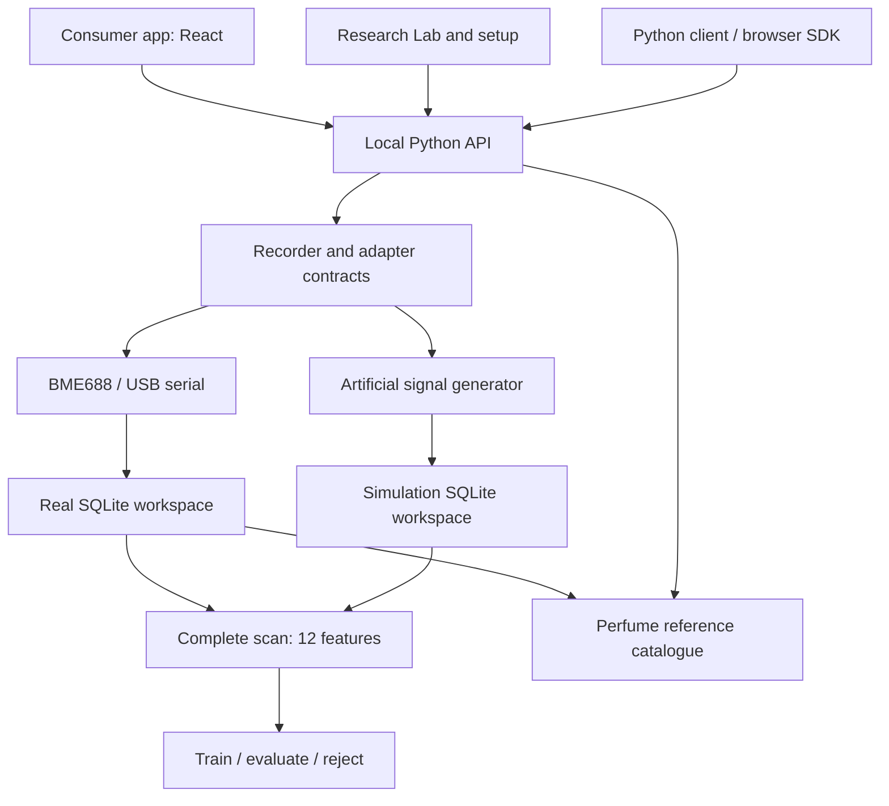

# Architecture

Olfy separates the scan experience from measurement transport, persistent data and classification. The consumer interface and research Lab use one local backend, so a saved scan has the same identity in either view.

## Acquisition and transport

`SensorInfo` declares adapter identity, physical device identity, sensor profile and channel units. Readings pass through a shared contract before recording. The BME688 adapter uses an MCP2221 USB bridge; the serial adapter accepts newline-delimited measurement packets from separately supplied firmware.

These interfaces make a new transport possible without embedding its driver in the UI. A new sensing modality still requires appropriate features, data and evaluation; a compatible packet alone does not establish scientific compatibility.

The consumer flow stores timed raw clips. The Lab records complete baseline, exposure and recovery phases. Only complete compatible reference scans enter the current feature/classification workflow. Disconnects preserve partial recordings with an error status.

## Data ownership and isolation

The workspace directory contains separate `real.sqlite3` and `simulation.sqlite3` databases and a reference catalogue. Real sensor errors stop acquisition instead of falling back to the generator. The 50 catalogue entries begin with identity/provenance information and no measured reference curves.

Raw readings remain the source data. Reference indexing connects measurements and derived features to an exact perfume variant while retaining device, profile, bottle, sample, collection day and conditions. Collection bookmarks store scan IDs; saving a result does not change its scientific status.

Full backups include scans, reference measurements, bookmarks, settings and model history. Restore verifies archive integrity and requires a fresh destination. Workspace locking prevents multiple app instances from writing into the same folder.

## Analysis boundaries

The current extractor computes 12 dimensionless values from baseline-normalized log resistance: four exposure bins, four recovery bins, exposure minimum/maximum/standard deviation and the recovery endpoint. Temperature, humidity and pressure remain available for inspection.

A scaler and logistic regression model are fitted on training scans. One whole collection day is excluded, and the application checks sample overlap, device/profile compatibility and scan timing. Unknown and blank controls are used for rejection checks instead of becoming known perfume classes.

The rejection rules are provisional research defaults. Generated-data scores exercise the implementation and establish no real perfume accuracy.

## Frontend and deployment

The React/TypeScript consumer source lives in `frontend/`. Vite writes its production build into `olfy/web/consumer/`; Python serves those assets alongside the Lab and setup pages. Normal startup needs Python and the pinned analysis dependencies, without Node or external application services.

The server listens on loopback. Its versioned API validates local origins and uses a runtime token for writes. This architecture is intended for a local researcher; internet hosting, shared accounts and remote hardware control need a separate deployment design.

## Next experiment

Verify the real USB hardware on the intended Mac, collect independent samples of a small perfume set, and evaluate on another collection day with blank/unfamiliar controls. The outcome should determine the next sensor configuration, feature set and accessory design.
